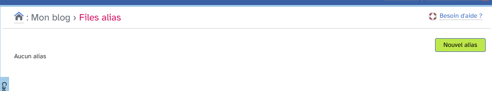
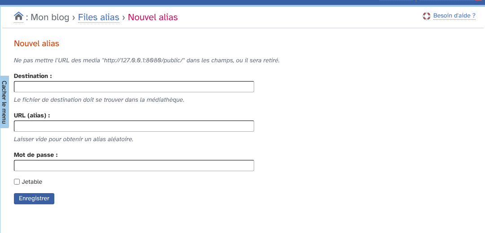
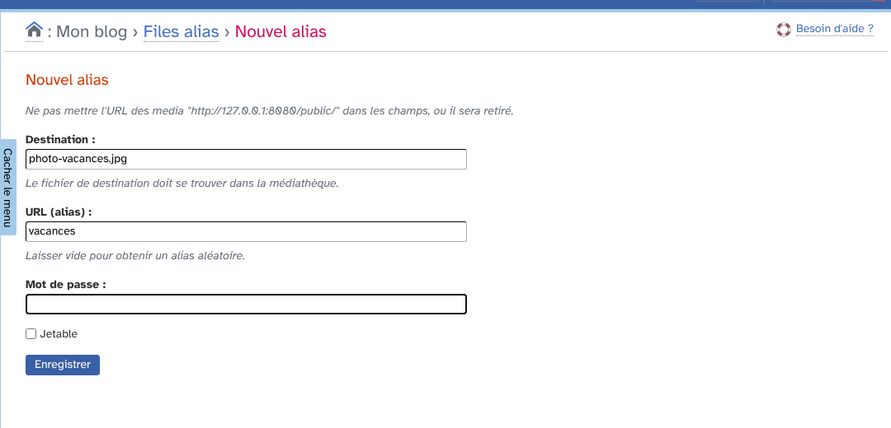
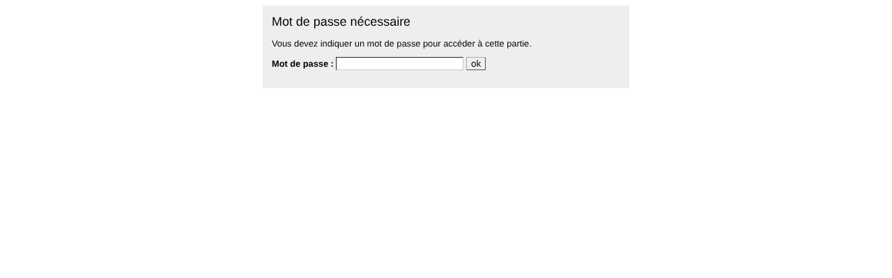
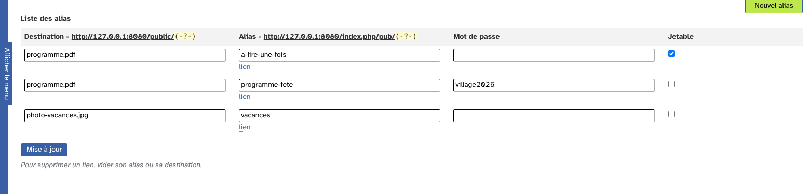

# filesAlias : guide d'utilisation

filesAlias crée des adresses publiques pour les fichiers de votre médiathèque.
Vous donnez une adresse courte à un fichier, et vous la partagez sans montrer l'adresse réelle du fichier.
L'adresse peut être protégée par un mot de passe, ou se supprimer toute seule après un téléchargement.

## Sommaire

* [Avant de commencer](#avant-de-commencer)
* [Créer un alias](#créer-un-alias)
* [L'adresse publique](#ladresse-publique)
* [Protéger par un mot de passe](#protéger-par-un-mot-de-passe)
* [Un alias jetable](#un-alias-jetable)
* [Voir et modifier les alias](#voir-et-modifier-les-alias)

## Avant de commencer

Le fichier doit déjà être dans la médiathèque de votre blog.
Envoyez-le avec le menu « Médiathèque » si ce n'est pas fait.

Ouvrez ensuite le menu « Plugins », puis « Files alias ».
Tant que vous n'avez pas créé d'alias, la page est vide.

## Créer un alias

Cliquez sur « Nouvel alias ».

Remplissez le formulaire :

* **Destination** : le nom du fichier dans la médiathèque, par exemple `photo-vacances.jpg`.
* **URL (alias)** : le nom court de l'alias, par exemple `vacances`. Laissez vide pour obtenir un nom aléatoire de 12 caractères, difficile à deviner.
* **Mot de passe** : facultatif, voir plus bas.
* **Jetable** : facultatif, voir plus bas.

Cliquez sur « Enregistrer ».
Si vous avez collé l'adresse complète du fichier de la médiathèque, le début de l'adresse est retiré tout seul.
Si le fichier n'est pas dans la médiathèque, un message d'erreur vous le dit.

## L'adresse publique

L'adresse publique d'un alias est l'adresse de votre blog suivie de `pub/` et du nom de l'alias.
Avec l'exemple ci-dessus, elle ressemble à `https://monblog.example/index.php/pub/vacances`.
L'adresse exacte dépend du réglage des adresses de votre blog.
La liste des alias l'affiche dans le titre de la colonne « Alias », et le lien « lien » ouvre l'alias.

Le visiteur qui ouvre l'adresse reçoit le fichier en téléchargement.
Il ne voit pas où le fichier est rangé sur votre site.
Une adresse inconnue affiche la page « Document non trouvé » du blog.

Si vous utilisez le plugin myUrlHandlers, vous pouvez remplacer `pub/` par un autre mot.

## Protéger par un mot de passe

Remplissez le champ « Mot de passe » de l'alias.
Le visiteur voit alors une page qui lui demande le mot de passe avant de recevoir le fichier.

Un mauvais mot de passe affiche de nouveau la page.
Le mot de passe est conservé tel que vous l'avez écrit, et il est visible dans la liste des alias : ne réutilisez pas un mot de passe important.

## Un alias jetable

Cochez « Jetable » : l'alias se supprime tout seul après avoir livré le fichier une fois.
La deuxième personne qui ouvre l'adresse voit la page « Document non trouvé ».

C'est pratique pour envoyer un fichier à une seule personne.
Associé à un nom d'alias aléatoire, il est très difficile à retrouver.

## Voir et modifier les alias

La page du plugin liste tous les alias du blog.

Chaque ligne montre la destination, l'alias, le mot de passe et la case « Jetable ».
Modifiez ce que vous voulez dans les champs, puis cliquez sur « Mise à jour » pour enregistrer toute la liste.
